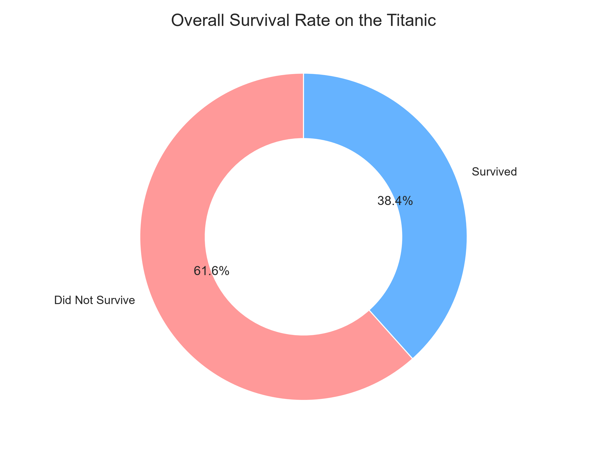
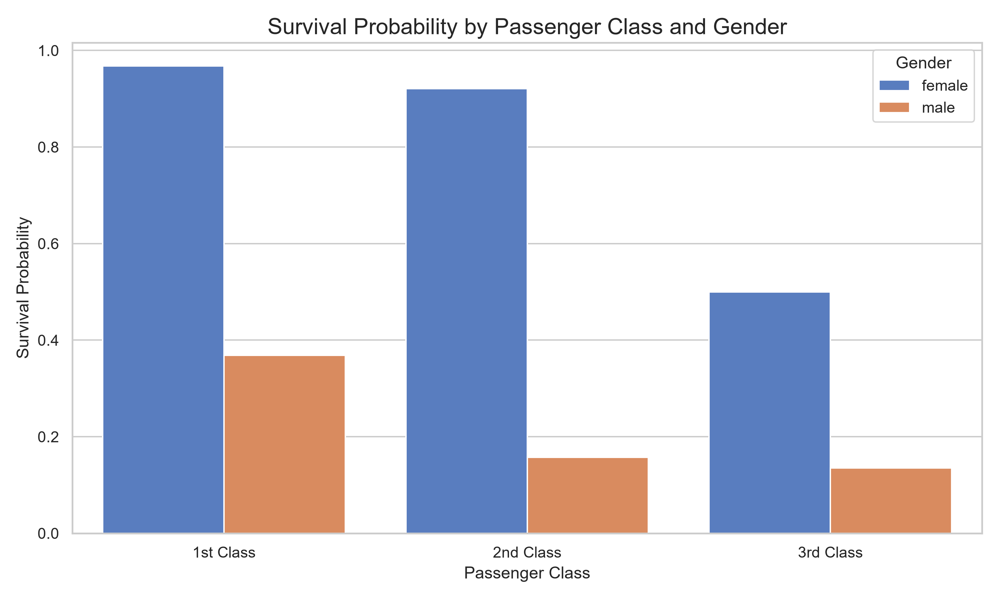
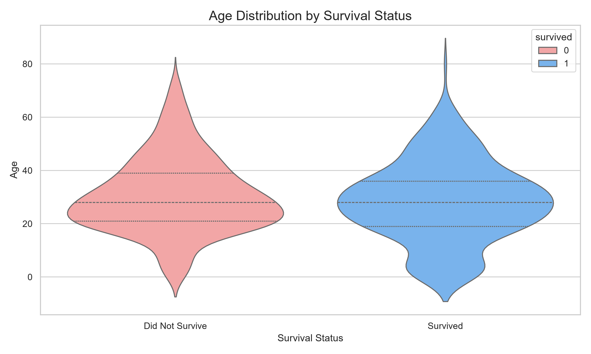
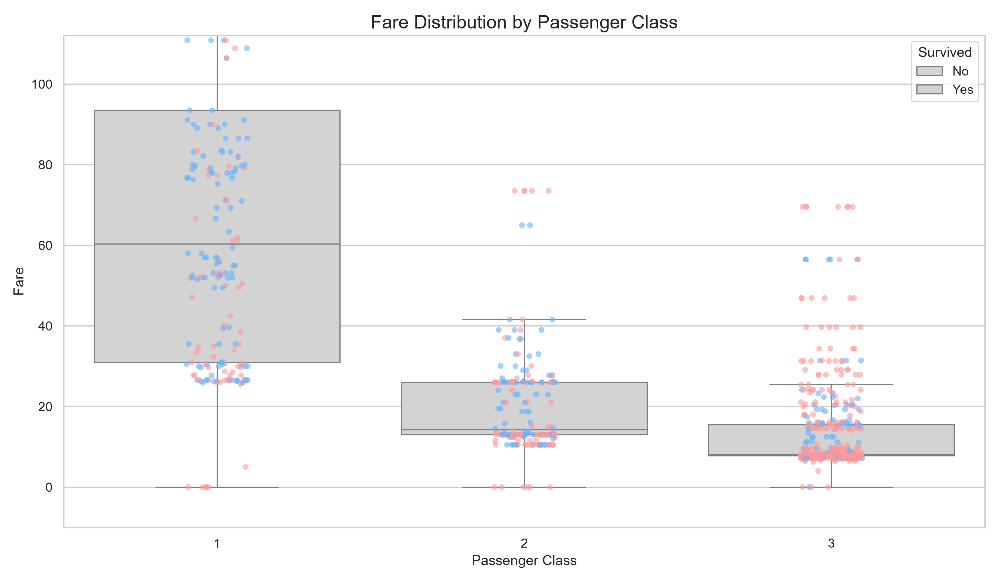
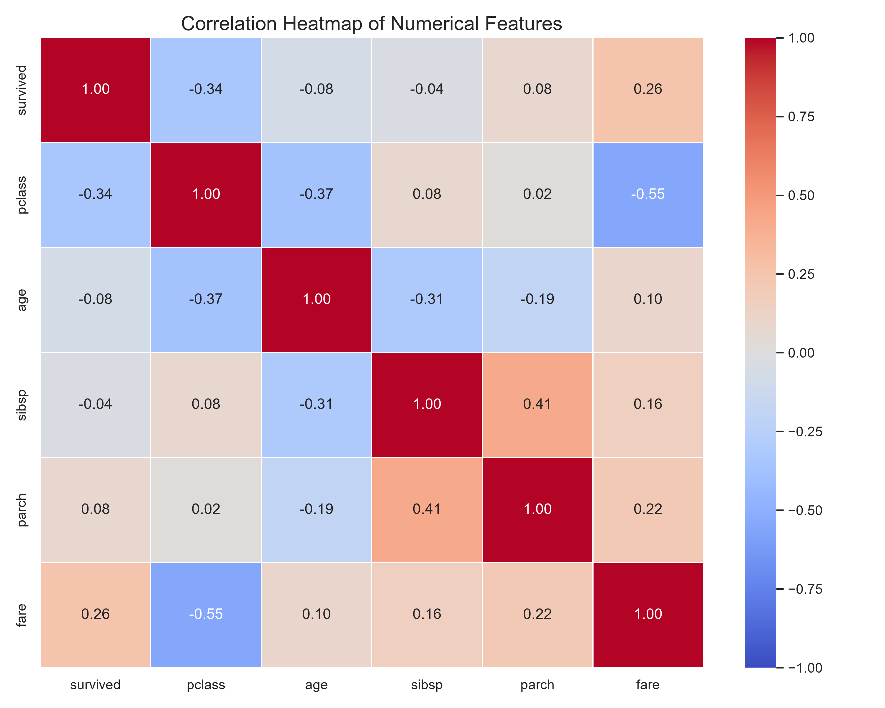

# Titanic Dataset: Advanced Data Visualization and Storytelling

## 📌 Project Overview
This project presents an end-to-end data visualization and storytelling analysis on the Titanic passenger dataset using Python. The objective is to uncover key patterns and communicate complex survival demographics to a non-technical audience through high-quality visual narratives.

---

## 📊 Visualizations & Key Insights

### 1. Overall Survival Rate (Donut Chart)
A quick, intuitive part-to-whole view illustrating the baseline survival rate on the Titanic.

* **Insight:** Only ~38.4% of passengers survived, setting the stage to explore which demographics survived.

---

### 2. Survival by Passenger Class and Gender (Grouped Bar Chart)
Comparing survival probabilities across socio-economic class and gender.

* **Insight:** Demonstrates the "women and children first" protocol, alongside stark class advantages (1st class women had >95% survival, whereas 3rd class men had <15%).

---

### 3. Age Demographics by Survival (Violin Plot)
Showing both summary statistics and full probability density of passenger ages.

* **Insight:** Young children had higher survival probability, while non-survivors clustered heavily around young adults aged 20–35.

---

### 4. Fare Distribution by Passenger Class (Box & Strip Plot)
Mapping ticket fares and individual passenger survival against passenger class.

* **Insight:** Wealthier passengers paying higher fares clustered heavily within the survival group.

---

### 5. Correlation Heatmap (Feature Relationships)
Quantifying linear relationships across all numerical attributes.

* **Insight:** Statistically validates negative correlation between class number and survival, and positive correlation between fare and survival.

---

## 🛠️ Tech Stack & Requirements
* **Python 3.10+**
* **Pandas** (Data manipulation)
* **Matplotlib** & **Seaborn** (Visualizations)
* **python-docx** (Automated Word report generation)

### Installation
```bash
pip install pandas matplotlib seaborn python-docx
```

### Running the Scripts
1. **Generate Visualizations:**
   ```bash
   python generate_plots.py
   ```
2. **Generate Word Document Report:**
   ```bash
   python create_docx.py
   ```

---

## 📄 Deliverables
* `generate_plots.py`: Python script generating all 5 charts.
* `create_docx.py`: Automated generator for the formatted submission Word report.
* `visualizations/`: High-resolution PNG exports of all generated plots.
* `Week2_Report.docx`: Comprehensive narrative report prepared for submission.
